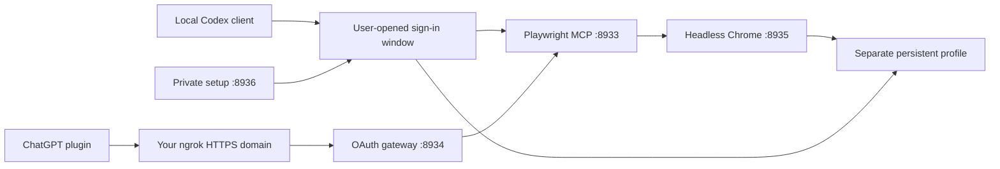

# Architecture and recovery

All local listeners bind to `127.0.0.1`. Only port **8934** belongs behind a public tunnel.

| Port | Component | Access |
| --- | --- | --- |
| 8933 | Raw Playwright MCP `/mcp` | Trusted local clients |
| 8934 | OAuth gateway `/mcp` and discovery/consent routes | Authenticated remote clients; public through the optional tunnel |
| 8935 | Chrome debugging | Internal local browser control |
| 8936 | Setup dashboard | Local owner using the private shortcut |

The service owns headless Chrome and its persistent profile, starts Playwright MCP through Chrome debugging, and maintains a browser connection so a client disconnect does not discard the shared context. The dashboard supervises the optional OAuth gateway and ngrok. Manual sign-in pauses browser use and hands the same profile back to the background service after saving.

The optional local stdio bridge is owned by the Codex client and remains alive when the browser manager restarts. Both it and the hosted gateway validate the upstream MCP session before forwarding a tool call. A stale upstream session is reinitialized before dispatch. Only explicit read-only operations may be retried after a transport failure; a potentially completed write returns an uncertain-completion error and is not replayed. The raw HTTP endpoint remains available for compatibility.

The sign-in helper launches installed Chrome directly with the dedicated profile and a loopback debugging port, then attaches through the supported Chrome debugging connection. It does not launch the sign-in window through WebDriver or modify browser identity signals. The connection restores and checkpoints the same private session state before the user navigates. Explicit Save checkpoints first, requests graceful shutdown of that owned Chrome instance, and waits for its process to exit before releasing the profile. Signing in successfully does not guarantee that a website will accept later headless access.

Session-only cookies ordinarily need not survive a full browser restart. The handoff helper saves them in protected local storage without inventing future expiry dates. It restores them once on launch and replaces snapshots during use, including logout. Websites can invalidate any saved session independently. This is session persistence, not a password manager or an automatic SSO/MFA bypass.

The availability supervisor adopts matching live parent processes and repairs missing parents. It probes periodically, uses bounded waits and backoff, and verifies installation-specific process identity before orphan cleanup. Chrome cleanup requires this installation's exact profile/debugging arguments and an explicit headless flag; it excludes headed login windows and renderer processes. PID creation time and a bound process handle guard against terminating a reused PID.

Inspection uses a single Windows process snapshot, checked against native process handles and creation times. Termination still rechecks fresh process identity. Inspection failures record safe classifications, timings, and output sizes; managed child exits record their exit code and signal when observed. Raw process arguments and error output are not included in these diagnostic receipts.

The native GUI launcher waits for the Node supervisor, restarting abnormal exits after 5, 10, 20, then at most 30 seconds. Exit 0 ends that launcher, including duplicate-owner and intentionally disabled cases. Operating-system startup/recovery configuration is installed for the owning user. Explicit Stop persists disabled policy before shutdown markers, so repair does not fight an intentional stop.

Recovery targets crashed/missing processes. A live but unhealthy parent is reported degraded and preserved. A powered-off or sleeping PC, expired login, exhausted tunnel quota, or lost internet connection requires its own remedy. Startup entries also depend on using a real path visible outside a packaged application's filesystem view.

All clients share one browser profile. Coordinate workflows rather than running competing navigation in parallel. This project is designed for one person's private machine, not a multi-user shared browser service.
